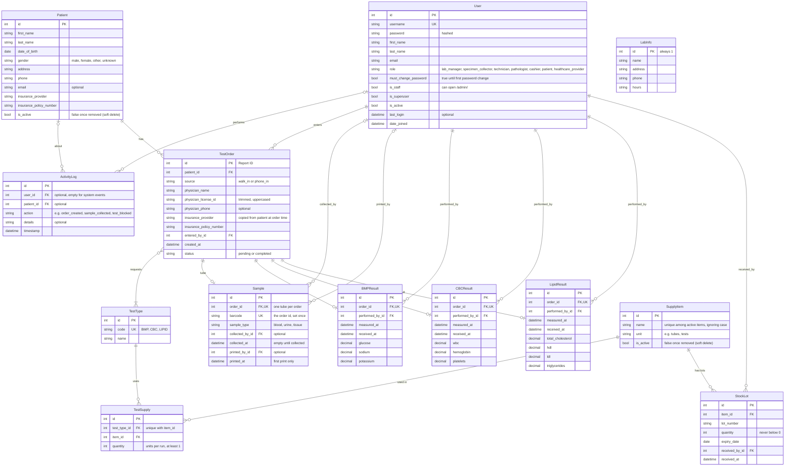

# Data Model

Every project table in the database today, read from the Django models. `billing/` has no models yet.
A picture of the same model is in [`docs/diagrams/data-model.drawio.png`](docs/diagrams/data-model.drawio.png).

## Notes

- **Apps:** `User`, `ActivityLog` and `LabInfo` are in `core`. `Patient`, `TestType`, `TestOrder`, `Sample` and the three result models are in `lab`. `SupplyItem`, `StockLot` and `TestSupply` are in `inventory`.
- **Django's own tables** are left out: `Group`, `Permission`, `ContentType`, `LogEntry` (admin log), `Session` and `django_migrations`. The app controls access with `User.role` (`core/decorators.py`), not groups or permissions.
- **No link between `User` and `Patient`.** `User.role = patient` is for a future patient login (SXFT-29). Patient records created by staff are not accounts.
- **Result models** share their fields through the abstract `PanelResult` base, which has no table of its own. Each order has at most one result per panel.
- **`TestOrder.tests`** is many-to-many, stored in the hidden join table `lab_testorder_tests`. `TestType` and `TestSupply` rows are seeded by migrations.
- **`LabInfo`** always saves as row 1, so there is only ever one.
- **Deletes:** links to `Patient`, `User`, `TestOrder` (from results) and `SupplyItem` are protected, so those rows can't be hard-deleted while something points at them. Patients and supply items are soft-deleted (`is_active`) instead. A `Sample` is deleted with its order, and `TestSupply` rows go with their test type. `ActivityLog` and `Sample` keep their row and empty the user or patient link if that row is removed.
